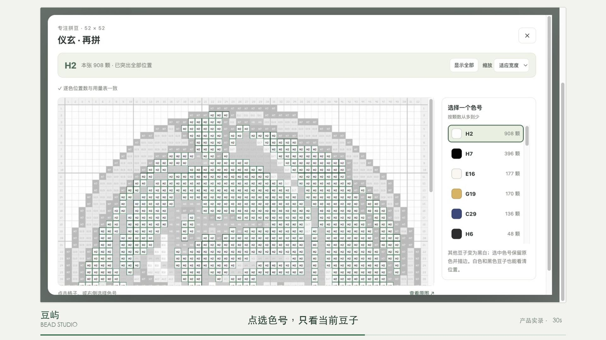
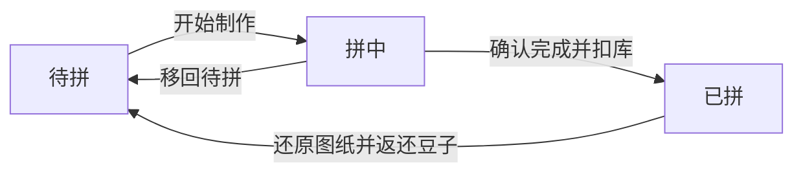

# 豆屿 · 拼豆管理

**把喜欢，拼进日常。**

豆屿是一个面向拼豆爱好者的小工具，把豆子库存、图纸收藏和制作过程放在一起：开拼前知道缺什么，拼的时候看清放哪里，完成后记清用了多少。

[观看 30 秒 Demo](bead-studio-demo-30s.mp4) · [下载视频](https://github.com/xyyylll/beads_tools/raw/refs/heads/main/bead-studio-demo-30s.mp4) · [产品入口](https://xinyu-bead-studio.honest-mouse-6474.chatgpt.site/)

> 产品入口目前需要访问权限。本仓库提供产品介绍和演示素材，尚未包含工具源码。

## 产品演示

点击封面观看视频。若 GitHub 页面未提供在线播放，可下载 MP4 后播放。

| 时间 | 演示内容 |
| --- | --- |
| 00:00–00:07 | 图纸收藏与 MARD 221 色库存概览 |
| 00:07–00:14 | 选择待拼图纸，检查所需、库存和缺少颗数 |
| 00:14–00:18 | 开始制作，进入拼中与专注模式 |
| 00:18–00:27 | 切换白色、蓝色、黑色色号，突出对应位置 |
| 00:27–00:30 | 恢复全部颜色，查看完整配色 |

视频为真实界面录制，使用独立本地演示数据，未修改线上库存。规格：**30 秒 · 1920 × 1080 · 30 fps · H.264 MP4**，画面含中文字幕，无音轨。

## 能做什么

### 1. 管好每一种豆子

- 按 MARD 色号查看当前库存，支持 221 色。
- 查看总库存、低库存色号和库存流水。
- 结合图纸用量，判断当前库存能否完成计划制作数量。

### 2. 管好每一张图纸

- 用「待拼 / 拼中 / 已拼」区分制作进度。
- 上传 JPG、PNG 或 WebP 图纸，通过视觉模型识别用量表中的色号与颗数。
- 识别结果按颗数从多到少排列，支持人工修正、重复色号与总量校验。
- 核对后保存到待拼；已拼图纸可以创建再拼副本，保留原制作记录。

### 3. 开拼前，先算清够不够

选择图纸和计划张数后，逐色展示：

| 色号 | 本次所需 | 当前库存 | 缺少 |
| --- | ---: | ---: | ---: |
| H2 | 908 | 2,783 | 0 |
| H7 | 396 | 1,572 | 0 |

上表为 Demo 中的部分数据。多张制作时，所需颗数随计划张数计算；库存不足时不能确认完成。

### 4. 拼的时候，只看当前颜色

- 点击色号或图纸中的豆子，对应位置保留原色并描边，其余位置变为黑白。
- 黑色、白色豆子同样有定位描边，方便逐色检查和补漏。
- 支持缩放、滚动和行列位置提示；点击同一色号或「显示全部」恢复配色。
- 已上传图纸无需重传，首次生成专注定位后保存复用；可调整网格范围、逐格修正定位。

## 制作与库存规则

| 操作 | 图纸变化 | 库存变化 |
| --- | --- | --- |
| 保存新图纸 | 添加到待拼 | 不扣豆 |
| 开始制作 | 待拼 → 拼中，保存计划张数 | 不扣豆，暂不预占库存 |
| 查看或切换专注色号 | 保持当前状态 | 不扣豆 |
| 完成制作 | 拼中 → 已拼 | 按计划张数扣除各色用量 |
| 移回待拼 | 拼中 → 待拼 | 不返还豆子，因为尚未扣库 |
| 删除图纸 | 移除图纸 | **不还原豆子**，保留已有耗豆影响 |
| 还原已拼图纸 | 清零完成次数，移回待拼 | **返还该图纸全部已完成次数消耗的豆子** |
| 再拼这张 | 新建独立的待拼副本 | 创建副本时不扣豆 |

开始制作不会锁定库存。多张图纸同时处于拼中时，能否完成以确认完成时的实际库存为准。

## 识别与数据保存

**识别需要核对。** 用量表识别和新图纸首次定位会调用 OpenAI 视觉模型，并发送相应图纸内容。小字号、压缩、水印和近似字形可能造成误读；保存用量前需人工确认。定位数量与用量不一致、无法读清的格子会提示核对，数量一致也不代表每个位置一定正确。

**已生成定位可以复用。** 首次生成定位按 API 用量计费；保存后，再次打开相同图片、切换色号和查看位置直接使用本地缓存，不重复调用模型。

**数据保存在当前浏览器。** 库存、图纸记录和定位修正刷新后保留，但不会自动跨浏览器或设备同步。请定期使用「导出备份」；备份包含已生成的定位，也可通过「导入备份」迁移数据。清理浏览器站点数据前应先备份。

库存按图纸颗数统计，未自动计入丢失、损耗等实际差异；屏幕色块仅作参考，选豆时请以实物色号为准。

## 仓库文件

| 文件 | 说明 |
| --- | --- |
| [bead-studio-demo-30s.mp4](bead-studio-demo-30s.mp4) | 30 秒产品实录，约 2 MB |
| [demo-cover.jpg](demo-cover.jpg) | 视频封面 |
| [demo-subtitles.zh-CN.srt](demo-subtitles.zh-CN.srt) | 可单独使用的中文字幕与时间轴 |
| [README.md](README.md) | 产品介绍与使用规则 |
